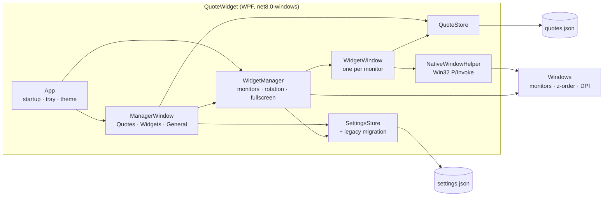
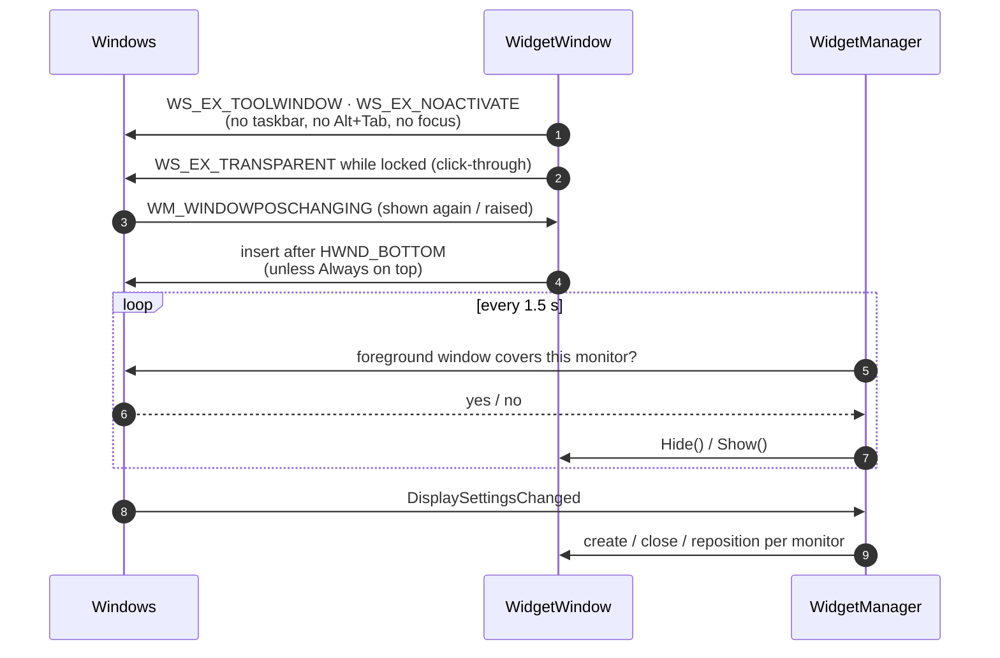
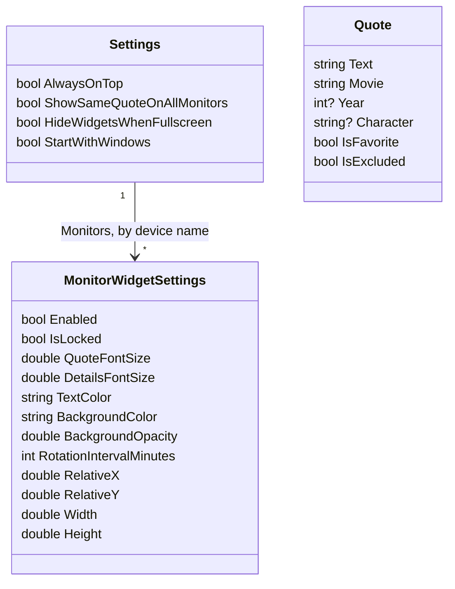

<div align="center">

# 🎬 Quote Widget

[](https://github.com/pero-grubac/Quote-Widget/actions/workflows/ci.yml)


**A small Windows desktop app that puts movie quotes on your wallpaper: one borderless widget per monitor, a new quote every few minutes, and a Fluent manager window for your collection.**


</div>

---

## 📌 Project Overview

**Quote Widget** keeps a quote from your favorite films on the desktop, right on top of the wallpaper and behind every program. It never steals focus, never shows up in the taskbar or Alt+Tab, and lets clicks pass straight through to the desktop. The app has two parts:

| Part | What it is | What you do there |
|------|------------|-------------------|
| 🖼️ **Widgets** | One transparent, borderless window per connected monitor | Read the quote; unlock it to drag and resize it |
| 🗂️ **Manager** | A Fluent (Windows 11 style) window with *Quotes*, *Widgets* and *General* pages | Manage quotes, style each monitor's widget, change app options |

The Manager opens on startup. Closing it frees its memory and the widgets keep running from the tray. The first run comes with 189 sample quotes, including a good dose of *Fight Club*.

---

## ✨ Features

- 🖥️ **One widget per monitor**: each with its own appearance, rotation interval, position and size, stored relative to that monitor so it survives resolution changes. Plug a monitor in or out and its widget appears or disappears; its settings are kept.
- 🔁 **Rotation**: a new random quote every *X* minutes (per monitor) with a soft fade, never the same quote twice in a row, or the *same quote on all monitors* at once
- ✍️ **Typography**: a large serif italic quote with the movie, year and character underneath. The widget auto-scales to fit and never cuts text off.
- 🗂️ **Quotes page**: live search, filters by movie, year and character, a *Show: All / Favorites / Hidden* filter, and grouping by movie, year or character
- ⭐ **Favorites and hidden quotes**: one click on a row's star makes it a favorite (shown 3× as often); hidden quotes stay in the list but never reach a widget
- ➕ **Add and edit** in a dialog with validation and duplicate detection; **delete** instantly with an **Undo** button
- 📥 **Import / export** JSON: invalid files get a clear error, duplicates are skipped, and you get a summary (*Imported 40, skipped 3 duplicates*)
- 🎨 **Widget appearance**: quote and details font size, text color, background color and opacity; copy one monitor's look to another or to all of them, or reset to defaults
- 🎮 **Fullscreen aware**: a widget hides while a game, video or F11 browser covers its monitor and comes back on its own
- ⚙️ **General**: always on top, start with Windows, hide while fullscreen
- 🧰 **Tray icon**: show/hide widgets, next quote, open the manager, exit
- 🪶 **Light**: about 25 MB of RAM while only the widgets run; single instance only

### 🪟 How a widget behaves

| State | Behavior |
|-------|----------|
| 🔒 *Locked* (default) | Click-through: the desktop under it stays fully usable |
| 🔓 *Unlocked* | Dashed outline; drag it anywhere, resize from any edge or corner |
| ⬇️ *Normal* (default) | Stays at the bottom of the window stack, above the wallpaper only; it never pops up over your programs |
| ⬆️ *Always on top* | Floats above every window |
| 🎮 *Fullscreen app on its monitor* | Hidden until the fullscreen app is gone (maximized windows don't count) |
| 🔌 *Monitor unplugged* | Widget closed, settings kept for when it comes back |

---

## 🛠️ Tech Stack

| Technology | Usage |
|------------|-------|
| .NET 8, C# | Application |
| WPF | Widget windows (transparent, borderless, `Viewbox` auto-scaling) |
| WPF-UI | Manager window: `FluentWindow`, `NavigationView`, `ContentDialog`, `Snackbar`, Mica, dark theme |
| H.NotifyIcon.Wpf | Tray icon and its menu |
| System.Text.Json | Quotes and settings as local JSON files |
| Win32 (P/Invoke) | Tool-window styles, click-through, bottom-of-stack z-order, per-monitor DPI, fullscreen detection |
| xUnit | Unit tests |
| GitHub Actions | CI and release builds |

---

## 📁 Repository Structure

```
Quote-Widget/
├── QuoteWidget/                WPF app
│   ├── Models/                 Quote, Settings, MonitorWidgetSettings
│   ├── Services/               QuoteStore, SettingsStore, MonitorService, MonitorSettingsService,
│   │                           WidgetManager, AutostartService, NativeWindowHelper
│   ├── Views/                  WidgetWindow (one per monitor), ManagerWindow
│   │   └── Pages/              Quotes, Widgets (+ MonitorCard), General, the add/edit dialog
│   ├── Data/                   Sample quotes for the first run
│   ├── Assets/                 app.ico, icon.svg
│   ├── app.manifest            Per-Monitor V2 DPI awareness
│   └── App.xaml(.cs)           Startup, tray icon, Fluent theme
├── QuoteWidget.Tests/          xUnit tests
├── tools/icon-generator/       Script that (re)generates Assets/app.ico
├── readme_assets/              Demo GIF and screenshots
├── .github/workflows/ci.yml    CI/CD
└── QuoteWidget.sln
```

---

## 🚀 Installation

### Download a build

Every tagged version (`v*`) is published on the [Releases](https://github.com/pero-grubac/Quote-Widget/releases) page as a single `QuoteWidget.exe`. It needs the [.NET 8 Desktop Runtime](https://dotnet.microsoft.com/download/dotnet/8.0) (or newer) and no installer: just run it.

### Build from source

#### Prerequisites

- Windows 10 or 11
- [.NET 8 SDK](https://dotnet.microsoft.com/download/dotnet/8.0)
- Optional: Visual Studio 2022 or JetBrains Rider

#### 1. Clone the repository

```bash
git clone https://github.com/pero-grubac/Quote-Widget.git
cd Quote-Widget
```

#### 2. Run

```bash
dotnet run --project QuoteWidget
```

Or open `QuoteWidget.sln` and start the **QuoteWidget** project. The Manager opens and a widget appears on every monitor.

#### 3. Publish a single exe (optional)

```bash
dotnet publish QuoteWidget -c Release -r win-x64 --self-contained false -p:PublishSingleFile=true
```

---

## 🧭 Usage

### Widgets

- Widgets start **locked**: they show the quote and let every click through to the desktop.
- To move one, open **Widgets** in the Manager and switch on that monitor's unlock toggle. Drag the widget, resize it from any edge or corner, or type exact X / Y / W / H on its card. Switch the toggle off to lock it again.
- The text scales with the widget's size, so a narrow widget shows the same quote, just smaller.

### Managing quotes

1. **Search** or narrow the list with the *Movie*, *Year*, *Character* and *Show* filters; *Clear* resets them. *Group by* groups the list by movie, year or character.
2. **Add** or double-click a row to **edit**: quote and movie are required, year and character optional. A quote that already exists (same text and movie) is refused.
3. Click the **☆** at the start of a row to make it a favorite (**★**). Select a row and use the **eye** button to hide it from the widgets.
4. **Delete** removes the quote at once; the notification has an **Undo** button that puts it back in its old place.

Every change is saved to `quotes.json` immediately; the widgets use it on their next rotation.

### Importing and exporting

- **Import...** reads a JSON file in the [quotes format](#-quotes-file-format), checks it, merges new quotes into your collection and skips duplicates.
- **Export...** saves the quotes currently shown (all of them, or just what your filters match) in the same format, which is handy for backups or moving to another PC.

### Widget appearance (Widgets page)

Each monitor has a card with its **Enabled** toggle, font sizes, text color, background color and opacity, rotation interval, position and size, and unlock toggle. Changes apply live. A card can **copy its appearance** to one other monitor or **to all monitors**, or **reset** that monitor. The page also has **Reset all monitors** and **Same quote on all monitors**.

### General page

**Always on top**, **Hide widgets while a fullscreen app is running** (on by default, checked every 1.5 s, per monitor) and **Start with Windows**.

### Tray

Right-click the tray icon for **Show/hide widgets**, **Next quote**, **Open manager** and **Exit**; double-click opens the Manager. Closing the Manager keeps the app running (a one-time notification says so); only **Exit** quits.

---

## 🗂️ Quotes file format

Everything lives in `%AppData%\QuoteWidget\`. `quotes.json` is created with the sample quotes on the first run; the same format is used for import and export:

```json
[
  {
    "quote": "May the Force be with you.",
    "movie": "Star Wars",
    "year": 1977,
    "character": "Han Solo"
  },
  {
    "quote": "The first rule of Fight Club is: you do not talk about Fight Club.",
    "movie": "Fight Club",
    "favorite": true
  }
]
```

| Field | Required | Notes |
|-------|:--------:|-------|
| `quote` | ✅ | The quote text |
| `movie` | ✅ | Movie title |
| `year` | | Release year |
| `character` | | Who says it |
| `favorite` | | `true` = shown 3× as often (omitted when `false`) |
| `excluded` | | `true` = never shown on a widget (omitted when `false`) |

`settings.json` holds the global options and one entry per monitor, keyed by its device name:

```json
{
  "AlwaysOnTop": false,
  "ShowSameQuoteOnAllMonitors": false,
  "HideWidgetsWhenFullscreen": true,
  "StartWithWindows": false,
  "Monitors": {
    "\\\\.\\DISPLAY1": {
      "Enabled": true, "IsLocked": true,
      "QuoteFontSize": 36, "DetailsFontSize": 16,
      "TextColor": "#FFFFFF", "BackgroundColor": "#000000", "BackgroundOpacity": 0,
      "RotationIntervalMinutes": 30,
      "RelativeX": 100, "RelativeY": 100, "Width": 700, "Height": 320
    }
  }
}
```

A missing or corrupt file is recreated with defaults, and a settings file from the older single-widget version is migrated into this shape automatically.

---

## 🏗️ Architecture

The app is deliberately small and flat: models, a few services, and the windows. `WidgetManager` owns one `WidgetWindow` per monitor; the Manager window is created when opened and destroyed when closed.



### How a widget stays out of your way



### Data model



---

## 🧭 Design Decisions

- **WPF.** Borderless, transparent, freely resizable windows with smooth text scaling are built in: a `Viewbox` scales the quote uniformly so it is never cut off.
- **WPF-UI for the Manager.** A real Fluent look (NavigationView, dialogs, snackbars, Mica) without hand-made control styles. The widgets stay plain WPF.
- **One window per monitor.** Each monitor has its own enabled state, look and position, which maps 1:1 onto how Windows models displays. Positions are stored relative to the monitor and DPI is handled per monitor (Per-Monitor V2).
- **Never over your programs.** Instead of only setting the z-order once, every z-order change is rewritten to `HWND_BOTTOM`, so being shown again can never raise the widget.
- **Plain JSON files.** Small, personal data with no concurrent access needs no database; the files are easy to read, back up and share, and the quotes format is also the import format.
- **Built to run all day.** Software rendering (the UI is almost static, so a GPU device only costs memory), a memory-conserving GC, and a Manager window that is destroyed and trimmed when closed. Each change was measured: from 289 MB down to ~25 MB with only the widgets running.

---

## 🧪 Tests

```bash
dotnet test
```

| Suite | Tests | Covers |
|-------|------:|--------|
| `QuoteStoreTests` | 18 | Sample/corrupt file recovery, import with duplicate skipping and validation errors, random pick without repeats, favorites weighting, hidden quotes, add/edit/delete, delete + undo position, duplicate check, export/import round trip |
| `SettingsStoreTests` | 12 | Legacy single-widget migration, defaults for missing fields, renaming a monitor key, apply / copy appearance to monitors, reset one or all monitors to defaults |
| `WidgetManagerTests` | 4 | Fullscreen detection geometry: exact and oversized windows, visible taskbar, another monitor |
| `NativeWindowHelperTests` | 2 | The z-order rule that turns a raise into "stay at the bottom" |

---

## ⚙️ CI/CD

[`.github/workflows/ci.yml`](.github/workflows/ci.yml) runs on pushes and pull requests to `main`:

| Job | Runner | Does |
|-----|--------|------|
| **test** | Windows | Restores (with NuGet cache), builds in Release, runs all tests |
| **build** | Windows | After the tests pass: publishes the single-file `win-x64` `QuoteWidget.exe` and uploads it as a workflow artifact |
| **release** | Windows | Only for tags `v*`, after test and build: publishes the exe and attaches it to a GitHub release with auto-generated notes |

CI **does not start** for Markdown, `readme_assets/` or the license.

```bash
git tag v1.0.0
git push origin v1.0.0
```

---

## 📄 License

[MIT](LICENSE) © Pero Grubač
